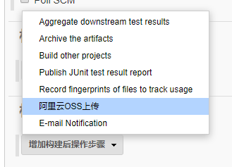
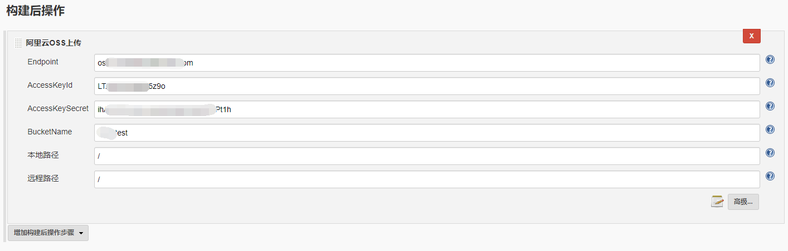

# Aliyun OSS Uploader for Jenkins

English | [简体中文](README.zh-CN.md)

## Requirements

Starting with 2.1.0, the plugin requires **Jenkins 2.479.3 or newer and Java 17 or 21**. Newer Jenkins releases may require a newer Java runtime. Upgrade Jenkins and the Java runtimes on the controller and all agents as needed before upgrading from an older plugin version.

The published 2.0.0 release still requires Jenkins 2.555.3 or newer and Java 21 or 25.

Existing job configuration, `aliyunOSSUpload` Pipeline parameters, the missing-file option, and object ACL settings remain compatible.

Building from source requires Maven 3.9.6 or newer and JDK 17/21. The Maven Wrapper uses Maven 3.9.9. Pipeline dependencies are managed by a BOM matching the Jenkins baseline.

## Usage

1. Clone the repository and build the plugin:

```bash
git clone https://github.com/jenkinsci/aliyun-oss-uploader-plugin.git
cd aliyun-oss-uploader-plugin
./mvnw verify
```

2. Upload the HPI file from `target` through the Jenkins plugin manager, install its dependencies, and restart Jenkins.
3. Add the **Aliyun OSS Upload** post-build action to a job.



4. Enter the OSS endpoint, credentials, bucket, and upload paths.



Local paths are relative to the workspace despite the leading `/`: `/abc` refers to `${WORKSPACE}/abc`. A file path uploads one file; a directory path uploads the directory recursively.

## Building

Normally, `./mvnw verify` runs the tests and builds the plugin. On Windows, use `mvnw.cmd verify`. The POM already declares the Jenkins public repository. Only adjust Maven settings when your network requires a custom repository configuration.

For such a configuration, add the following fragments to `~/.m2/settings.xml` as needed.

In `mirrors`:

```xml
<mirror>
  <id>repo.jenkins-ci.org</id>
  <url>https://repo.jenkins-ci.org/public/</url>
  <mirrorOf>m.g.o-public</mirrorOf>
</mirror>
```

In `pluginGroups`:

```xml
<pluginGroup>org.jenkins-ci.tools</pluginGroup>
```

In `profiles`:

```xml
<profile>
  <id>jenkins</id>
  <activation>
    <activeByDefault>true</activeByDefault>
  </activation>
  <repositories>
    <repository>
      <id>repo.jenkins-ci.org</id>
      <url>https://repo.jenkins-ci.org/public/</url>
    </repository>
  </repositories>
  <pluginRepositories>
    <pluginRepository>
      <id>repo.jenkins-ci.org</id>
      <url>https://repo.jenkins-ci.org/public/</url>
    </pluginRepository>
  </pluginRepositories>
</profile>
```

To package without running tests:

```bash
mvn clean package -DskipTests
```

To run Jenkins locally for development:

```bash
mvn clean hpi:run
```

## Release documentation

- [2.1.0 release notes](docs/releases/2.1.0.md)
- [2.1.0 release and downloads](https://github.com/jenkinsci/aliyun-oss-uploader-plugin/releases/tag/aliyun-oss-uploader-2.1.0)
- [2.0.0 release notes](docs/releases/2.0.0.md)
- [2.0.0 release and downloads](https://github.com/jenkinsci/aliyun-oss-uploader-plugin/releases/tag/aliyun-oss-uploader-2.0.0)
