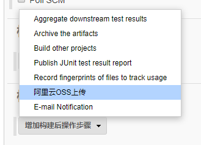
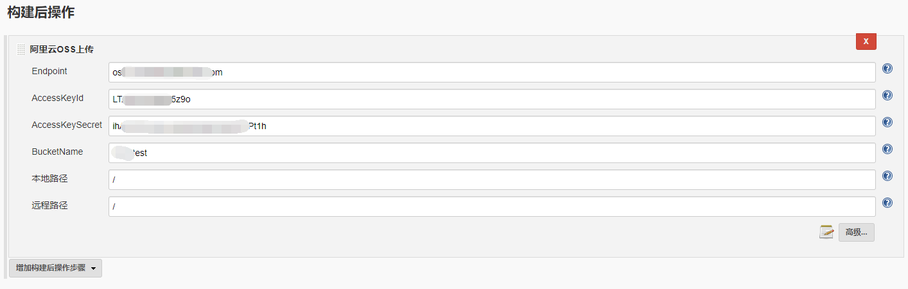

# jenkins阿里云OSS上传插件

[English](README.md) | 简体中文

## 兼容要求

此开发版本要求 **Jenkins 2.555.3 或更新版本、Java 21 或 25**。
从旧版本升级前，请先升级 Jenkins 控制器与所有代理的 Java 和 Jenkins 版本。
已有任务配置、`aliyunOSSUpload` Pipeline 参数、缺失文件开关和对象 ACL 配置保持兼容。

构建要求 Maven 3.9.6 或更新版本及 JDK 21/25；仓库的 Maven Wrapper 使用 Maven 3.9.9。
Pipeline 依赖由与 Jenkins 基线匹配的 BOM 统一管理。

## 使用

1.下载源码&编译

```bash
git clone https://github.com/jenkinsci/aliyun-oss-uploader-plugin.git
cd aliyun-oss-uploader-plugin
./mvnw verify
```
2.在plugins管理页面上传target下的hpi文件并安装，重启jenkins

3.修改项目，增加`构建后操作`，选择`阿里云OSS上传`


4.填写阿里云OSS配置信息


> 本地路径为相对于workspace的路径，例如填写为`/abc`，则本地路径为`${WORKSPACE}/abc`
本地路径可以设置为文件或目录。如果设置为文件则上传单个文件，设置为目录上传整个目录

## 构建

通常直接使用 `./mvnw verify`（Windows 使用 `mvnw.cmd verify`）即可完成测试与打包；
POM 已包含 Jenkins 公共仓库配置。仅在企业网络需要自定义仓库时才需调整下面的 Maven 设置。

1. 修改`${USER}/.m2/settings.xml`中的maven配置文件

在`mirrors`节点中增加
```xml
<mirror>
  <id>repo.jenkins-ci.org</id>
  <url>https://repo.jenkins-ci.org/public/</url>
  <mirrorOf>m.g.o-public</mirrorOf>
</mirror>
```
在`pluginGroups`节点中增加
```xml
<pluginGroup>org.jenkins-ci.tools</pluginGroup>
```
在`profiles`节点中增加
```xml
<profile>
  <id>jenkins</id>
  <activation>
    <activeByDefault>true</activeByDefault>
  </activation>
  <repositories>
    <repository>
      <id>repo.jenkins-ci.org</id>
      <url>https://repo.jenkins-ci.org/public/</url>
    </repository>
  </repositories>
  <pluginRepositories>
    <pluginRepository>
      <id>repo.jenkins-ci.org</id>
      <url>https://repo.jenkins-ci.org/public/</url>
    </pluginRepository>
  </pluginRepositories>
</profile>
```

2. 打包
```bash
mvn clean package -DskipTests
```

3. 运行
```bash
mvn clean hpi:run
```

## 发布文档

- [2.0.0 发布说明草稿](RELEASE_NOTES.zh-CN.md)
- [2.0.0 发布准备记录](RELEASE_PREPARATION.zh-CN.md)
